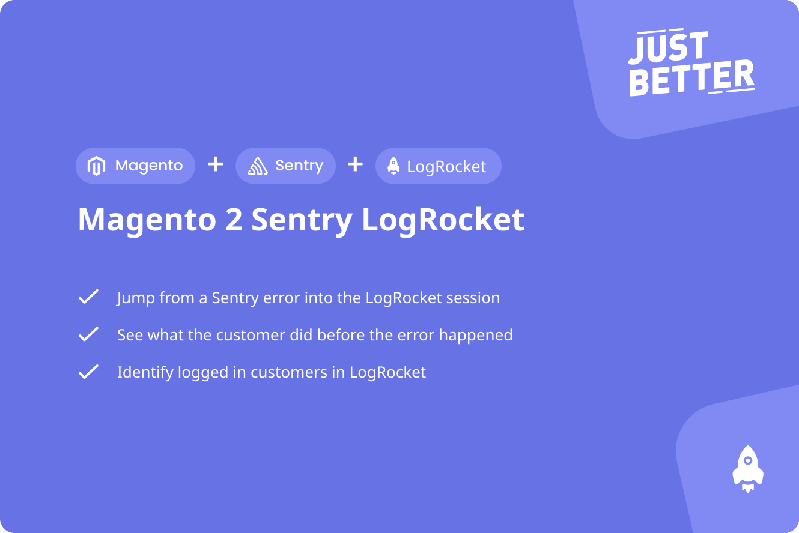

<a href="https://github.com/justbetter/magento2-sentry-logrocket" title="JustBetter">
    
</a>

# Magento 2 Sentry LogRocket
[](https://packagist.org/packages/justbetter/magento2-sentry-logrocket)
[](https://packagist.org/packages/justbetter/magento2-sentry-logrocket)

[](https://github.com/justbetter/magento2-sentry-logrocket/actions/workflows/analyse.yml)

This module adds [LogRocket](https://logrocket.com) session replay to [`justbetter/magento2-sentry`](https://github.com/justbetter/magento2-sentry).
It loads the LogRocket script tag next to the Sentry script tag, and attaches the LogRocket session URL to the
Sentry event context as `sessionURL`, so you can jump from a Sentry issue straight into the LogRocket session
that caused it.

LogRocket support used to be built into `justbetter/magento2-sentry` itself. Since `magento2-sentry` 5.0.0 it has
been extracted into this separate module, so that shops that don't use LogRocket no longer carry its config
fields, CSP rule and customer-data plugin.

## Features

- Loads the LogRocket script tag whenever the Sentry script tag is enabled
- Attaches the LogRocket session URL to the Sentry event context (`sessionURL`)
- Optionally identifies the logged in customer to LogRocket (name + email)
- Adds the LogRocket CDN to the Content-Security-Policy `script-src` whitelist

## Requirements

- `justbetter/magento2-sentry` `^5.0` (LogRocket must be configured through the Sentry module's script tag settings)

## Installation
- `composer require justbetter/magento2-sentry-logrocket`
- `bin/magento module:enable JustBetter_SentryLogrocket`
- `bin/magento setup:upgrade`
- `bin/magento setup:di:compile`
- `bin/magento setup:static-content:deploy`

## Upgrading from magento2-sentry 4.x
If you were already using LogRocket through `justbetter/magento2-sentry` 4.x, upgrade to `magento2-sentry` 5.0.0
and install this module. No configuration changes are needed — the config paths and `env.php` key are unchanged.
If you don't use LogRocket, you can safely upgrade `magento2-sentry` to 5.0.0 without installing this module.

## Configuration
This module reuses the JustBetter Sentry configuration under `Stores > Configuration > JustBetter > Sentry configuration`.
The LogRocket script tag is only rendered when Sentry's own `Enable Javascript Tracking` is enabled.

### Configuration values
| Name | Location | Description |
|---|---|---|
| `Use LogRocket` | General config | Enables the LogRocket script tag. |
| `LogRocket include user data` | General config | Identifies the logged in customer to LogRocket with their name and email. |
| `Logrocket Key` | Environment Configuration | Your LogRocket app ID, e.g. `example/example`. |

Alternatively, the LogRocket key can be set through the [Magento Deployment Configuration](https://devdocs.magento.com/guides/v2.3/config-guide/config/config-php.html)
in `app/etc/env.php`, under the same `sentry` array used by `justbetter/magento2-sentry`:

```
'sentry' => [
    'logrocket_key' => 'example/example',
]
```

### Content-Security-Policy
When LogRocket is enabled, `https://cdn.lr-ingest.io` is automatically added to the `script-src` CSP policy.

## Compatibility
The module is tested on Magento version 2.4.x with `justbetter/magento2-sentry` 5.x.

## Ideas, bugs or suggestions?
Please create a [issue](https://github.com/justbetter/magento2-sentry-logrocket/issues) or a [pull request](https://github.com/justbetter/magento2-sentry-logrocket/pulls).

## Contributing
Contributing? Awesome! Thank you for your help improving the module!

Please see [CONTRIBUTING](.github/CONTRIBUTING.md) for details.

Most importantly:
- When making a PR please add a description what you've added, and if relevant why.
- To save time on codestyle feedback, please run
    - `composer install`
    - `composer run codestyle`
    - `composer run analyse`

## Security Vulnerabilities

Please review [our security policy](../../security/policy) on how to report security vulnerabilities.

## License

The MIT License (MIT). Please see [License File](LICENSE) for more information.

<a href="https://justbetter.nl" title="JustBetter">
    
</a>
